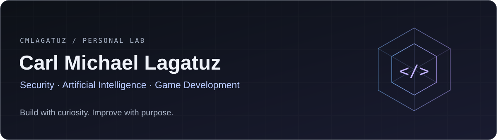

  

<h1 align="center">Hi, I'm Zantetsuken.</h1>

  <b>Cybersecurity Specialist · Game Developer · Researcher</b> 
  Exploring secure systems, personal AI, and interactive worlds.

  
  

  <a href="#featured-projects">Projects</a> &nbsp; / &nbsp;
  <a href="#tools-in-my-projects">Tools</a> &nbsp; / &nbsp;
  <a href="#current-focus">Current focus</a> &nbsp; / &nbsp;
  <a href="#lets-connect">Connect</a>

---

## About me

I build across **cybersecurity, AI, game development, and practical web applications**. My projects range from a personal AI assistant that runs on a PC to a mobile MOBA and tools that simplify recruitment workflows.

I'm interested in how systems work, how they can fail, and how thoughtful interfaces make them easier to use. This profile brings together my experiments, ongoing projects, and research.

## Featured projects

### C.L.A.I.R.E. · Personal AI

A personal AI assistant built around local models, voice interaction, memory, and a desktop web interface. Its action workflow asks for permission before carrying out supported tasks on the PC.

**Built with:** Python · Ollama  
[Explore CLAIRE →](https://github.com/cmlagatuz/CLAIRE)

### Project D · Zantetsuken

A mobile-first 5v5 MOBA project built in Unity, exploring touch controls, customizable HUDs, combat systems, and a playable duel test bed. A fan-made, educational, non-commercial project inspired by Dissidia.

**Built with:** Unity · C# · Universal Render Pipeline  
[Explore Project D →](https://github.com/cmlagatuz/Project-D) · [Duel demo guide](https://github.com/cmlagatuz/Project-D/blob/main/docs/duel-demo.md)

### Safwat Recruitment Toolkit · Workflow tools

A browser-based workspace for recruitment pipelines, visa reporting, client operations, and document tasks. Brings candidate follow-ups, reporting, and everyday administrative tools into one interface.

**Built with:** JavaScript · HTML · CSS · Firebase  
[Explore the toolkit →](https://github.com/cmlagatuz/safwat-recruitment-toolkit)

### Ryzen VPN · Android

A native Android VPN client using WireGuard, with configuration import, location selection, and connection controls.

**Built with:** Kotlin · Android · WireGuard  
[Explore Ryzen VPN →](https://github.com/cmlagatuz/Ryzen-VPN)

<b>More from my workspace</b>

 

[**Dawney Clinic**](https://github.com/cmlagatuz/dawney-clinic) — A web-based veterinary clinic tracking project.

[**Browse all repositories →**](https://github.com/cmlagatuz?tab=repositories)

## Tools in my projects

| Area | Languages & tools |
| :--- | :--- |
| AI & automation | Python, Ollama |
| Game development | C#, Unity, URP |
| Web applications | JavaScript, HTML, CSS, Firebase |
| Android | Kotlin, Android SDK, WireGuard |
| Development workflow | Git, GitHub |

## Current focus

- **Personal AI:** developing CLAIRE's voice, memory, and user-controlled actions.
- **Game development:** refining Project D's combat, interface, and mobile experience.
- **Practical software:** making recruitment workflows and Android tools easier to use.
- **Security & research:** exploring systems and documenting what I learn.

<b>GitHub activity & language overview</b>

 

  

  

These optional cards depend on an external service. Language totals reflect repository contents, not proficiency.

[View my activity directly on GitHub →](https://github.com/cmlagatuz?tab=overview)

---

## Let's connect

I'm open to conversations and collaboration around **security research, personal AI, game development, and useful software**.

[**Visit my portfolio**](https://cmlagatuz.dev) · [**Explore my research profile**](https://orcid.org/0009-0005-3575-4253)

Curiosity → experiments → better tools.

